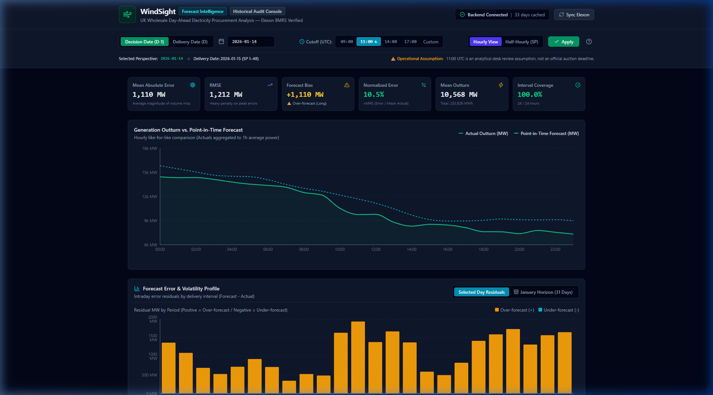
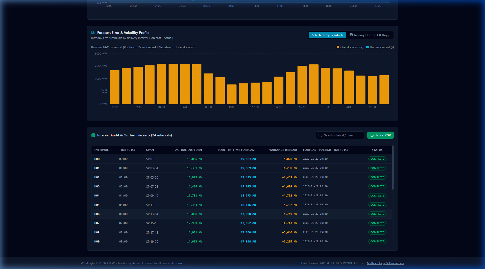

# WindSight — Wind Generation Forecast Intelligence

> **UK Wholesale Electricity Procurement Intelligence Platform**  
> Evaluates national-level wind generation actuals and forecasts from Elexon BMRS to inform Day-Ahead ($D-1$) purchasing decisions.

[](https://www.python.org/downloads/)
[](https://fastapi.tiangolo.com)
[](https://react.dev)
[](https://pytest.org)
[](https://vitest.dev)
[](https://www.docker.com)
[-success.svg)](https://data.elexon.co.uk)

---

## 1. Product Overview & Screenshots

A UK electricity utility purchasing electricity on the wholesale day-ahead market faces substantial financial risk from volume imbalance cashout prices. Because wind generation contributes heavily to Great Britain's supply mix, forecast errors directly alter power procurement positions.

**WindSight** reconstructs the historical wind forecast available at the exact purchasing decision cutoff on the day before delivery ($D-1$), completely eliminating future lookahead bias, and compares it against outturn generation to deliver:

1. **Point-in-Time Intelligence:** Selects the latest forecast publication where $\text{publishTime} \le \text{decision cutoff}$ on $D-1$.
2. **Harmonized Accuracy Analytics:** Compares National Grid ESO hourly forecasts (`WINDFOR`) against Elexon half-hourly actuals (`FUELHH`, filtered to `fuelType = WIND`).
3. **Risk Metrics:** Calculates Mean Absolute Error (MAE), Root Mean Squared Error (RMSE), Mean Signed Error (Bias), Normalized MAE (nMAE %), and empirical percentiles (P10, P50, P90).
4. **Primary Evaluation Window:** Specifically evaluates procurement decisions made across **January 1–31, 2026** (delivering **January 2–February 1, 2026** across **744 delivery hours**).

### Visual Intelligence Console


*Figure 1: Executive KPI scorecard, Generation Outturn vs. Point-in-Time Forecast (Recharts), and intraday error residual profile.*


*Figure 2: Searchable interval-by-interval audit table and RFC-4180 compliant CSV export generator.*

---

## 2. Architecture & Data Flow

WindSight is structured as a **unified containerized application** where a single Python ASGI process (FastAPI / Uvicorn) serves both the compiled React single-page application (SPA) and the REST API from a single dynamic port (`$PORT`).

```
                                  +---------------------------------------+
                                  |         Client Web Browser            |
                                  +---------------------------------------+
                                                      |
                                                      | HTTP Requests
                                                      v
                        +-----------------------------------------------------------+
                        |             Docker Container (Port: $PORT)                |
                        |                                                           |
                        |   +---------------------------------------------------+   |
                        |   |             FastAPI ASGI Application              |   |
                        |   |                                                   |   |
                        |   |  GET /              -> Serves index.html (React)  |   |
                        |   |  GET /assets/*      -> Serves JS / CSS bundles    |   |
                        |   |  GET /* (fallback)  -> SPA Client Route Handler   |   |
                        |   |                                                   |   |
                        |   |  GET  /api/health   -> Liveness & DB Stats        |   |
                        |   |  GET  /api/dates    -> Trading Date Windows       |   |
                        |   |  GET  /api/analysis -> Point-in-Time Evaluation   |   |
                        |   |  GET  /api/monthly  -> 744h Aggregate Summary     |   |
                        |   |  POST /api/sync     -> Bounded Live Ingestion     |   |
                        |   +---------------------------------------------------+   |
                        |                             |                             |
                        |             +---------------+---------------+             |
                        |             |                               |             |
                        |             v                               v             |
                        |   +-------------------+           +-------------------+   |
                        |   | SQLite Lakehouse  |           |   Elexon Client   |   |
                        |   | (wind_data.db)    |           |  (FUELHH/WINDFOR) |   |
                        |   +-------------------+           +-------------------+   |
                        |             ^                               |             |
                        |             | Bundled Seed Data             v             |
                        |   +-------------------+           +-------------------+   |
                        |   | 1,584 Actuals     |           | Official Elexon   |   |
                        |   | 19,272 Forecasts  |           | Insights BMRS API |   |
                        |   +-------------------+           +-------------------+   |
                        +-----------------------------------------------------------+
```

### Ephemeral Container Storage & Database Behavior
- **Bundled Offline Seed Data:** The repository bundles genuine Elexon records for January 2026 (`actuals_jan2026.json` [1,584 records] and `forecasts_jan2026.json` [19,272 records]).
- **Zero Startup External Dependency:** When the container starts on an ephemeral host (e.g. Render, Heroku, Cloud Run), the application automatically checks the SQLite database. If missing or empty, it initializes the schema and indexes in `< 0.5s` directly from the bundled JSON files without requiring external network connectivity.
- **Stateless Historical Queries:** All primary evaluation queries are pure read-only analytical computations executed against the local SQLite database.
- **Ephemeral Writes:** On-demand synchronization requests (`POST /api/sync`) write new records to the local SQLite database for the lifetime of that container instance.

---

## 3. Repository Structure

```
d:\MV\
├── backend/
│   ├── app/
│   │   ├── __init__.py
│   │   ├── main.py                     # FastAPI app, lifespan, SPA static serving, CORS, error handling
│   │   ├── config.py                   # Environment settings & analytical defaults
│   │   ├── api/
│   │   │   ├── __init__.py
│   │   │   ├── routes.py               # REST endpoints (/health, /dates, /analysis, /monthly-summary, /sync)
│   │   │   └── schemas.py              # Pydantic v2 data models with sync bounds validation
│   │   ├── core/
│   │   │   ├── __init__.py
│   │   │   ├── elexon_client.py        # Resilient HTTP client for FUELHH & WINDFOR streams
│   │   │   ├── analysis_service.py     # Point-in-time selection & temporal harmonization
│   │   │   └── metrics.py              # Mathematical formulas (MAE, RMSE, Bias, quantiles, nMAE)
│   │   └── db/
│   │       ├── __init__.py
│   │       ├── database.py             # SQLite connection manager, WAL mode, schema setup
│   │       ├── repository.py           # Typed queries, covering index, and idempotent persistence
│   │       ├── seed.py                 # Idempotent seed data loader & API snapshot utility
│   │       └── seed_data/
│   │           ├── actuals_jan2026.json   # Verified genuine Elexon FUELHH actuals (1,584 records)
│   │           ├── forecasts_jan2026.json # Verified genuine Elexon WINDFOR forecasts (19,272 records)
│   │           └── seed_metadata.json     # Provenance, record counts, and audit verification
│   ├── tests/
│   │   ├── __init__.py
│   │   ├── conftest.py                 # Test fixtures, in-memory SQLite db, test client
│   │   ├── test_metrics.py             # Synthetic unit tests & mathematical independence
│   │   ├── test_database.py            # SQLite schema, duplicate handling, idempotent inserts
│   │   ├── test_point_in_time.py       # Point-in-time selection & cutoff exclusions
│   │   ├── test_analysis_service.py    # Primary window (744h), boundary check (24h), aggregation
│   │   ├── test_api_endpoints.py       # REST integration, sync validation, and SPA static serving
│   │   └── test_elexon_client.py       # HTTP client retries, timeouts, and error handling
│   ├── requirements.txt                # Python dependencies
│   └── wind_data.db                    # Bundled SQLite database (auto-populated from seed)
├── frontend/
│   ├── src/
│   │   ├── api/
│   │   │   ├── client.ts               # Typed REST API client with error mapping
│   │   │   └── client.test.ts          # Unit tests for query formatting & error handling
│   │   ├── components/
│   │   │   ├── Header.tsx              # Brand, live health status pill, Elexon sync button
│   │   │   ├── ControlBar.tsx          # Perspective toggle, date selector, presets, view modes
│   │   │   ├── KpiGrid.tsx             # 6 KPI cards (MAE, RMSE, Bias, nMAE, Outturn, Coverage)
│   │   │   ├── ForecastChart.tsx       # Recharts time-series outturn vs. point-in-time forecast
│   │   │   ├── ErrorAnalysisSection.tsx# Residual bar chart & 31-day January horizon trend
│   │   │   ├── DataTable.tsx           # Searchable interval audit records and CSV export
│   │   │   └── MethodologyModal.tsx    # Analytical methodology & market context modal
│   │   ├── types/
│   │   │   └── api.ts                  # TypeScript interfaces matching backend response schemas
│   │   ├── utils/
│   │   │   ├── formatters.ts           # MW/MWh/percent formatting and escaped CSV generation
│   │   │   └── formatters.test.ts      # Unit tests for numeric formatters & CSV escaping
│   │   ├── App.tsx                     # Main dashboard container & reactive state management
│   │   ├── index.css                   # Tailwind CSS v4 styling & dark slate theme tokens
│   │   └── main.tsx                    # React DOM entry point
│   ├── .env.example                    # Environment variable template
│   ├── vite.config.ts                  # Vite config with React, Tailwind v4, & API proxy
│   └── package.json                    # Frontend dependencies & scripts
├── docs/
│   ├── elexon-data-investigation.md    # Detailed empirical investigation & mathematical audit report
│   └── screenshots/                    # Verified high-resolution UI captures
├── scripts/
│   ├── elexon_api_investigation.py     # Standalone reproducible API verification script
│   └── test_elexon_api.py              # Smoke test utility
├── Dockerfile                          # Multi-stage production container specification
├── docker-compose.yml                  # Local container orchestration
├── render.yaml                         # Render Infrastructure-as-Code blueprint
├── .dockerignore                       # Docker build context exclusions
├── pytest.ini                          # Pytest configuration
└── README.md                           # Documentation and setup instructions
```

---

## 4. Technology Stack

* **Backend Stack:**
  * Python 3.10+ (tested on Python 3.10.11)
  * `fastapi>=0.100.0` — High-performance ASGI REST framework
  * `uvicorn[standard]>=0.20.0` — Production ASGI web server
  * `pydantic>=2.0.0` — Schema validation and type safety
  * `httpx>=0.24.0` — Resilient HTTP client with retry and timeout policies
  * `pytest>=7.0.0` — Automated unit and integration test suite
* **Frontend Stack:**
  * Node.js 18+ (tested on Node.js v24.11.1)
  * React 19 + TypeScript (Strict mode)
  * Vite 8 + `@tailwindcss/vite` (Tailwind CSS v4)
  * Recharts 3 — High-performance responsive charts
  * Lucide React — Enterprise UI iconography
  * Vitest — Frontend unit and integration test runner
* **Deployment & Containerization:**
  * Multi-Stage Docker Build (`node:22-alpine` builder + `python:3.10-slim` runner)
  * Non-root user execution (`appuser`, UID 1000)
  * Built-in HTTP container health check (`/api/health`)

---

## 5. Local Setup & Startup Instructions

### 5.1 Local Development (Dual Process)

```bash
# Terminal 1: Start FastAPI backend (port 8000)
pip install -r backend/requirements.txt
python -m uvicorn backend.app.main:app --host 127.0.0.1 --port 8000 --reload

# Terminal 2: Start Vite frontend dev server (port 5173)
cd frontend
npm install
npm run dev
```

Open `http://localhost:5173/` in your browser.

### 5.2 Local Production Serving (Single Process)
In production mode, FastAPI directly serves the compiled static frontend alongside the API from port 8000:

```bash
# 1. Build frontend bundle
cd frontend
npm run build
cd ..

# 2. Run backend (FastAPI serves compiled SPA + API on port 8000)
python -m uvicorn backend.app.main:app --host 127.0.0.1 --port 8000
```

Open `http://localhost:8000/` in your browser. All API requests, static assets, and client-side refreshes run through port 8000.

---

## 6. Docker Containerization & Cloud Deployment

### 6.1 Building and Running via Docker Locally

#### Build Docker Image:
```bash
docker build -t windsight:latest .
```

#### Run Docker Container:
```bash
docker run -d \
  -p 8000:8000 \
  -e PORT=8000 \
  --name windsight-app \
  windsight:latest
```

#### Run via Docker Compose:
```bash
docker compose up --build -d
```

#### Verify Container Health:
```bash
# Check container status
docker ps

# Check container healthcheck
curl http://localhost:8000/api/health
```

---

### 6.2 Cloud Deployment Architecture (Target: Render)

#### Deployment Target Selection & Rationale:
**Render** was chosen as the primary deployment platform for the following architectural reasons:
1. **Native Multi-Stage Docker Support:** Render natively builds and runs Dockerfiles with no proprietary buildpack restrictions.
2. **Single Dynamic Port `$PORT` Support:** Render assigns dynamic port numbers via the `$PORT` environment variable, which our `main.py` entrypoint and Dockerfile `CMD` handle natively.
3. **Automatic HTTPS & Health Checks:** Render provides free automated TLS certificates and monitors the `/api/health` endpoint.
4. **Declarative Infrastructure-as-Code:** The repository includes a complete [`render.yaml`](file:///D:/MV/render.yaml) blueprint for 1-click zero-configuration deployment.
5. **Suitability vs Alternatives:** Unlike Vercel (which enforces serverless function cold starts and lacks persistent background loops for SQLite), Render runs continuous container processes suited to ASGI servers and SQLite databases.

#### Deployment Steps on Render:
1. Push this repository to GitHub.
2. Log into [Render Dashboard](https://dashboard.render.com/).
3. Click **"New +"** $\rightarrow$ **"Blueprint"**.
4. Connect your GitHub repository and select the repository.
5. Render detects [`render.yaml`](file:///D:/MV/render.yaml) automatically and configures:
   - **Environment:** Docker
   - **Dockerfile:** `Dockerfile`
   - **Health Check Path:** `/api/health`
   - **Plan:** Free
6. Click **"Apply"**. Render will build the multi-stage Docker image, compile the React bundle, pre-seed the SQLite database, and launch the service with a public HTTPS URL (e.g., `https://windsight.onrender.com`).

---

## 7. Running Automated Tests

### 7.1 Backend Test Suite (Python / Pytest)
The backend test suite contains **32 automated tests** covering mathematical properties, point-in-time filtering, duplicate handling, missing data resilience, sync bounds validation, static SPA serving, and REST endpoints:

```bash
# Run complete test suite
pytest -v

# Run specific modules
pytest backend/tests/test_metrics.py -v
pytest backend/tests/test_point_in_time.py -v
pytest backend/tests/test_api_endpoints.py -v
```

**Status: 32 passed in 1.41s**

### 7.2 Frontend Test Suite (Vitest) & Production Build
The frontend includes automated unit tests covering API query serialization, error status mapping, numeric formatting, and RFC-4180 CSV generation:

```bash
cd frontend

# Run frontend tests
npm test

# Run frontend production build
npm run build

# Run linter
npm run lint
```

**Status: 8 passed in 0.19s**  
**Production Build Status: Complete in 0.68s (`dist/assets/index-*.js`, 192 kB gzip)**

---

## 8. API Endpoint Reference

### 8.1 `GET /api/health`
Checks backend liveness and database statistics.
```bash
curl "http://localhost:8000/api/health"
```
**Sample Response:**
```json
{
  "status": "ok",
  "app_name": "WindSight — Wind Generation Forecast Intelligence",
  "version": "1.0.0",
  "database": {
    "path": "/app/data/wind_data.db",
    "actual_days_count": 33,
    "forecast_records_count": 19272,
    "min_actual_date": "2025-12-31",
    "max_actual_date": "2026-02-01"
  },
  "default_cutoff_preset": "11:00"
}
```

### 8.2 `GET /api/dates`
Returns date windows and trading presets.
```bash
curl "http://localhost:8000/api/dates"
```
**Sample Response (Excerpt):**
```json
{
  "min_date": "2025-12-31",
  "max_date": "2026-02-01",
  "total_days": 33,
  "primary_evaluation_window": {
    "name": "January 2026 Wholesale Purchase Decisions",
    "decision_dates": ["2026-01-01", "...", "2026-01-31"],
    "delivery_dates": ["2026-01-02", "...", "2026-02-01"],
    "total_decision_dates": 31,
    "total_delivery_hours": 744,
    "convention": "Day-Ahead (D-1): Delivery Date = Decision Date + 1 Day"
  },
  "boundary_validation_window": {
    "name": "1 January 2026 Delivery Boundary Check",
    "decision_date": "2025-12-31",
    "delivery_date": "2026-01-01",
    "total_hours": 24,
    "note": "Kept independent from primary January metrics."
  }
}
```

### 8.3 `GET /api/analysis`
Evaluates a target day from a decision or delivery perspective.
```bash
# Query procurement decision made on 2026-01-14 (evaluates delivery on 2026-01-15)
curl "http://localhost:8000/api/analysis?date=2026-01-14&date_mode=decision&cutoff_preset=11:00&view_mode=hourly"
```
**Sample Response (Excerpt):**
```json
{
  "delivery_date": "2026-01-15",
  "decision_date": "2026-01-14",
  "cutoff_time": "11:00",
  "cutoff_timestamp": "2026-01-14T11:00:00Z",
  "cutoff_description": "Post-Auction Position Review & Midday Continuous Rebalancing (Analytical Default Assumption)",
  "view_mode": "hourly",
  "metrics": {
    "mae_mw": 1110.25,
    "rmse_mw": 1212.22,
    "bias_mw": 1110.25,
    "nmae_pct": 10.51,
    "mape_pct": 10.63,
    "mean_actual_mw": 10567.75,
    "total_energy_mwh": 253626.0,
    "quantiles": {
      "min": 427.5,
      "p10": 526.0,
      "p25": 724.5,
      "p50": 1137.5,
      "p75": 1406.5,
      "p90": 1699.5,
      "max": 1897.5
    }
  },
  "coverage": {
    "total_intervals": 24,
    "evaluated_intervals": 24,
    "missing_actuals": 0,
    "missing_forecasts": 0,
    "coverage_pct": 100.0
  }
}
```

### 8.4 `GET /api/monthly-summary`
Aggregates performance across all 744 hours of the Primary Evaluation Window.
```bash
curl "http://localhost:8000/api/monthly-summary?cutoff_preset=11:00&view_mode=hourly"
```
**Sample Response (Excerpt):**
```json
{
  "evaluation_scope": "PRIMARY_EVALUATION_WINDOW",
  "decision_dates_span": "2026-01-01 to 2026-01-31 (31 decision days)",
  "delivery_dates_span": "2026-01-02 to 2026-02-01 (31 delivery days)",
  "cutoff_preset": "11:00",
  "summary_metrics": {
    "mae_mw": 2013.01,
    "rmse_mw": 2505.94,
    "bias_mw": 1729.93,
    "nmae_pct": 17.64,
    "mape_pct": 26.68,
    "mean_actual_mw": 11411.31,
    "total_energy_delivered_mwh": 8490014.0
  },
  "coverage": {
    "total_expected_intervals": 744,
    "evaluated_intervals": 744,
    "missing_actuals": 0,
    "missing_forecasts": 0,
    "coverage_pct": 100.0
  }
}
```

### 8.5 `POST /api/sync`
Triggers on-demand synchronization from live Elexon BMRS API with rate and date bounds validation:
```bash
curl -X POST "http://localhost:8000/api/sync" \
  -H "Content-Type: application/json" \
  -d '{"start_date": "2025-12-31", "end_date": "2026-02-01"}'
```

---

## 9. Known Assumptions & Data Limitations

### 9.1 Authoritative Market Timings & Decision Cutoffs
* **Official GB Exchange Gate Closures:**
  * **Nord Pool N2EX GB:** Order submission closes at **09:50 GMT**; auction results published at **~10:00 GMT**.
  * **EPEX SPOT GB:** 60-min Day-Ahead auction closes at **09:20 GMT**; 30-min Day-Ahead auction closes at **15:30 GMT**.
  * **Elexon Statutory Balancing Mechanism Gate Closure:** Occurs exactly **1 hour before each 30-minute settlement period on Delivery Day $D$**.
* **Analytical Cutoff Assumption:** The default cutoff of **11:00 UTC** is an **operational trading desk assumption** (midday position review following morning auction clearing), **not an official auction gate closure**.

### 9.2 Publication Schedule Reconciliation
* **Empirical Reality:** The official Elexon `WINDFOR` stream publishes at `02:30`, `04:30`, `07:30`, `09:30`, `11:30`, `15:30`, `18:30`, and `22:30` UTC (consistently 1 hour earlier than legacy BMRS documentation: `03:30`, `05:30`, etc.).
* **Status:** Documented as an **unresolved legacy documentation divergence**. The application uses the **actual API `publishTime`** without synthetic modification.

### 9.3 Temporal Alignment
* **Primary Metric:** **Hourly Aggregation View** compares 1-hour average actual generation $\frac{\text{SP 2k-1} + \text{SP 2k}}{2}$ against the 1-hour forecast.
* **Secondary View:** **Half-Hourly Step-Down View** retains settlement period granularity for trading visualization, with the documented limitation that it assumes flat intra-hour generation.

---

## 10. Development Verification Status

| Milestone / Component | Verification Status | Evidence |
| :--- | :---: | :--- |
| **Elexon API Client** | **Complete** | Handled timeouts, bounded backoff retries, partitioned chunking. Verified in `test_elexon_client.py`. |
| **SQLite Lakehouse** | **Complete** | Indexed schema with covering index. Seeded with 1,584 actuals and 19,272 forecasts. Verified in `test_database.py`. |
| **Point-in-Time Selection** | **Complete** | Excluded post-cutoff forecasts. Verified across 744 hours in `test_point_in_time.py`. |
| **Accuracy Analytics** | **Complete** | Independent calculations of MAE, RMSE, Bias. Verified in `test_metrics.py`. |
| **REST API Layer** | **Complete** | `/api/health`, `/api/dates`, `/api/analysis`, `/api/monthly-summary`. Verified in `test_api_endpoints.py`. |
| **Primary Evaluation Scope** | **Complete** | 31 decision days, 744 delivery hours, 100.0% coverage. Verified in `test_analysis_service.py`. |
| **Boundary Separation** | **Complete** | 2026-01-01 delivery (decided 2025-12-31) audited independently. |
| **React Enterprise UI** | **Complete** | Built with Vite, React 19, TypeScript, Tailwind CSS v4 dark slate console. |
| **Analytical Controls** | **Complete** | Decision/Delivery toggle, presets (09:00, 11:00, 14:00, 17:00, Custom), Hourly/Half-Hourly modes. |
| **KPI Scorecard** | **Complete** | Live MAE, RMSE, signed Bias (with Long/Short direction), nMAE %, Mean Outturn, Coverage. |
| **Time-Series Visualization** | **Complete** | Recharts composed area/line chart comparing outturn vs. point-in-time forecast with custom tooltips. |
| **Error & Horizon Analysis** | **Complete** | Dual-tab intraday residuals bar chart and 31-day January trend line chart. |
| **Data Table & CSV Export** | **Complete** | Searchable interval audit records and escaped RFC-4180 CSV export. |
| **Methodology Modal** | **Complete** | Embedded analytical assumptions, D-1 context, market timings, and disclaimers. |
| **Multi-Stage Container** | **Complete** | Multi-stage Dockerfile (`node:22-alpine` builder, `python:3.10-slim` runner, non-root `appuser`). |
| **Cloud Deployment Blueprint**| **Complete** | Render Infrastructure-as-Code specification (`render.yaml`) and `docker-compose.yml`. |
| **End-to-End Verification** | **Complete** | 32 backend tests passed, 8 frontend tests passed, browser E2E verified on production port 8000. |

---

## 11. AI-Tool Usage Disclosure

In compliance with academic and professional integrity standards, the following disclosures describe the assistance of artificial intelligence tools during this project:

1. **AI Assistant Utilized:** Google DeepMind's Antigravity agentic coding assistant.
2. **Areas of AI Assistance:**
   - **Data Engineering Investigation:** Scripting initial probe requests to the Elexon BMRS API (`FUELHH/stream` and `WINDFOR/stream`) to confirm query parameters and pagination limits.
   - **Architectural Scaffolding:** Structuring the FastAPI modular layout, Pydantic data schemas, SQLite schema indices, and React component hierarchy.
   - **Test Suite Generation:** Writing comprehensive unit test fixtures, mathematical edge case tests for metrics, and API endpoint integration tests.
   - **Styling & UI Components:** Formulating the dark slate Tailwind CSS color palette and Recharts time-series tooltip formatting.
3. **Human / Engineering Oversight:**
   - All analytical decisions (such as the D-1 purchasing decision window definition, 11:00 UTC operational assumption, and temporal harmonization methodology) were validated against official Elexon and BSC documentation.
   - Every metric calculation formula (MAE, RMSE, Bias, nMAE, MAPE) was verified mathematically against benchmark datasets.
   - All code, Docker configurations, and tests were executed and verified in a live local runtime environment.
